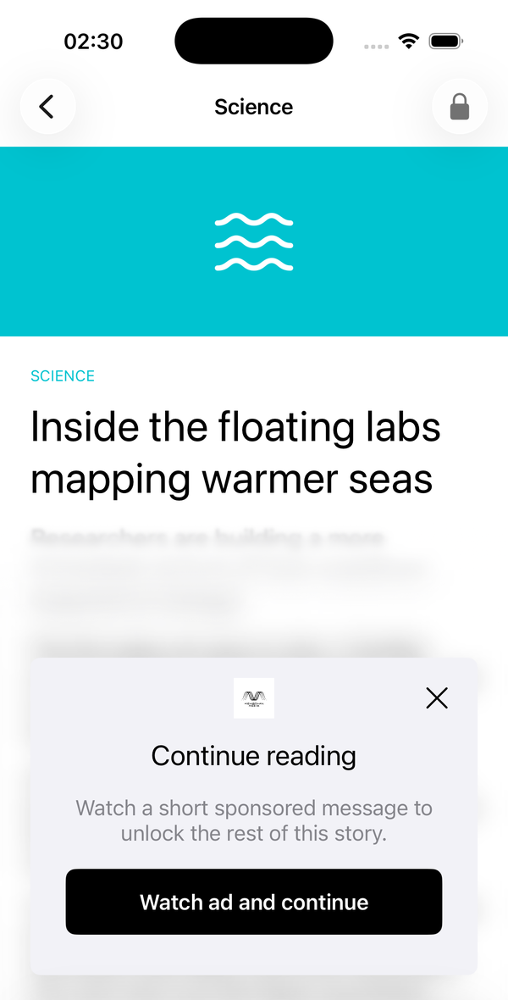
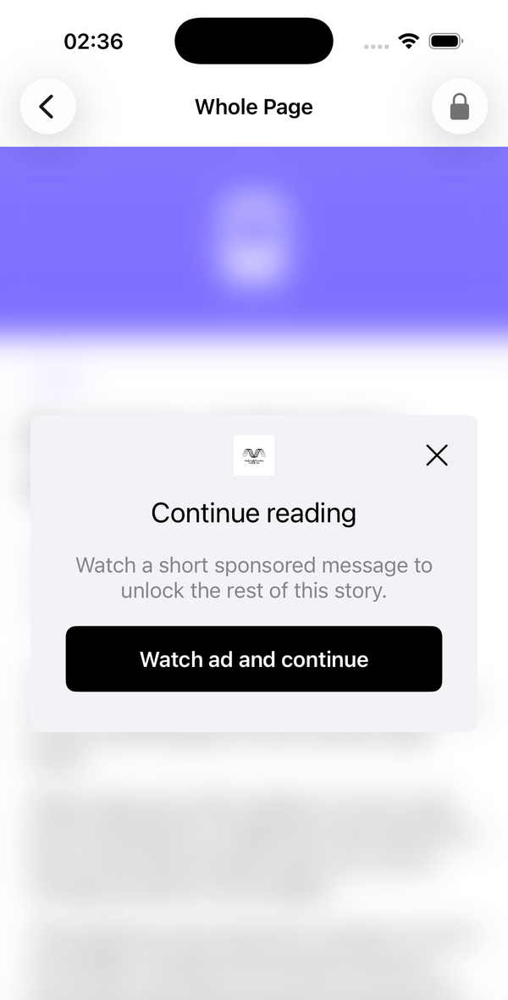
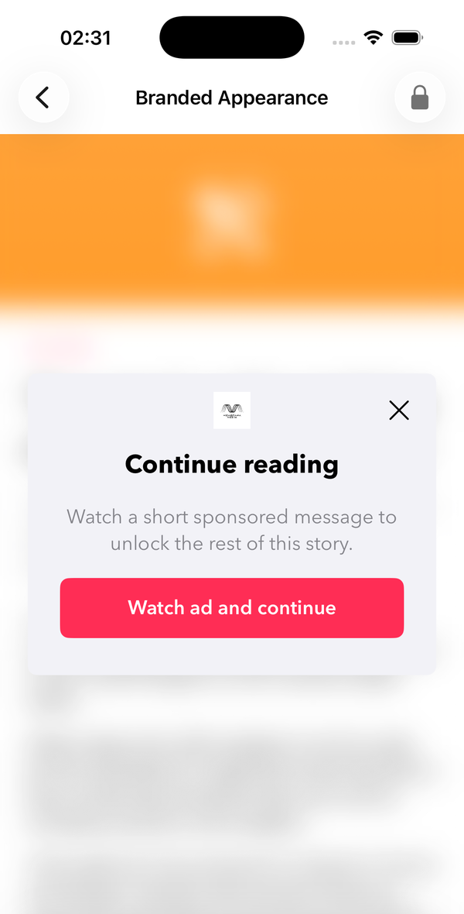

# Membrana AdWall SDK for iOS

Membrana AdWall is an iOS 15+ SDK that exchanges access to protected publisher content for a
rewarded ad impression. A publisher-supplied view defines where protection starts; the wall spans
the presenting view controller and extends from that edge through its bottom. Localized text and an
optional logo come from the Membrana settings API, and a gate is never shown unless its rewarded
inventory is already loaded.

<p align="center">
  
  
</p>

<p align="center">
  <sub>Left: protection starting at a view partway down the article. Right: the whole article
  protected, with the host's navigation bar left untouched.</sub>
</p>

## Requirements

- iOS 15.0 or later deployment target
- Xcode 26.2 or newer, required by Google Mobile Ads 13
- A Membrana App ID, supplied by the Membrana team for your application
- A Google Mobile Ads application ID, also supplied by the Membrana team, which you declare in your
  app's `Info.plist`

The SDK is a static XCFramework. Google Mobile Ads is resolved as a package dependency and is **not**
embedded inside the Membrana binary, so your application keeps a single copy of GMA and can update
it independently. No Google Mobile Ads type appears in the Membrana public API.

## Install with Swift Package Manager

### Xcode

1. Choose **File > Add Package Dependencies…**.
2. Enter the package URL:

   ```text
   https://github.com/notsy-bv/adwall_mobile_sdk_ios_resources
   ```

3. Set **Dependency Rule** to **Up to Next Major Version** starting at `1.0.2`, or pin the
   exact version approved for your integration.
4. Add the **MembranaAdWallSDK** library product to your application target.

Xcode resolves
[`swift-package-manager-google-mobile-ads`](https://github.com/googleads/swift-package-manager-google-mobile-ads)
(13.11.0 or later, below 14.0) transitively. Do not add Google Mobile Ads separately.

### Package.swift

```swift
dependencies: [
    .package(
        url: "https://github.com/notsy-bv/adwall_mobile_sdk_ios_resources.git",
        from: "1.0.2"
    )
],
targets: [
    .target(
        name: "YourApp",
        dependencies: [
            .product(name: "MembranaAdWallSDK", package: "adwall_mobile_sdk_ios_resources")
        ]
    )
]
```

## Configure the host application

Add the Google Mobile Ads application ID supplied by the Membrana team to `Info.plist`:

```xml
<key>GADApplicationIdentifier</key>
<string>YOUR_GMA_APPLICATION_ID</string>
```

Add Google's `SKAdNetworkItems` list so installs can be attributed without the IDFA. Google
maintains the canonical list and adds buyers to it over time — copy the current entries from
[Prepare privacy strategies](https://developers.google.com/ad-manager/mobile-ads-sdk/ios/privacy/strategies)
(the AdMob edition is at
[developers.google.com/admob/ios/privacy/strategies](https://developers.google.com/admob/ios/privacy/strategies))
and re-check it when you update Google Mobile Ads:

```xml
<key>SKAdNetworkItems</key>
<array>
    <dict>
        <key>SKAdNetworkIdentifier</key>
        <string>cstr6suwn9.skadnetwork</string>
    </dict>
    <!-- Remaining identifiers from Google's current list. -->
</array>
```

Every example app in
[`notsy-bv/adwall_mobile_sdk_examples`](https://github.com/notsy-bv/adwall_mobile_sdk_examples)
ships the full list and can be used as a starting point.

The host application also owns:

- `NSUserTrackingUsageDescription`, if your consent flow requests App Tracking Transparency.
- Any request settings required by your CMP, mediation partners, or regional policy.

Membrana AdWall does not display consent UI and does not own consent state. Finish your privacy and
consent flow before starting the SDK. If consent changes later, see
[Consent changes](#consent-changes); for the data the SDK itself sends, see [Privacy](#privacy).

## Start the SDK

Keep one `MembranaAdWall` instance as an application-level dependency and start it after
advertising is permitted:

```swift
import MembranaAdWallSDK

@MainActor
final class AdWallService {
    let adWall = MembranaAdWall(appId: "YOUR_MEMBRANA_APP_ID")

    func startAfterAdvertisingIsPermitted() async throws {
        try await adWall.start()
    }
}
```

`start()` loads Membrana settings, initializes advertising, and begins preparing rewarded demand. If
it throws, do not install gates — keep your normal fallback experience instead.

Presentation APIs do not wait for `start()`. A request made before successful startup reports
`.notInitialized` once and is not replayed.

## Protect content

### Choosing what gets covered

There is no presentation-style flag. The view you pass to `gate` is what decides whether the wall
covers the whole page or only part of it:

```swift
// Whole page: protect the view controller's complete root view.
adWall.gate(view, in: self, delegate: self)

// Partial: keep the introduction readable, then cover from this view's top edge
// down to the bottom of the screen.
adWall.gate(articleGateView, in: self, delegate: self)
```

The supplied view's on-screen frame defines where the wall *begins* vertically. The presenting view
controller defines the horizontal span and the bottom edge, so coverage always runs from that
boundary through the bottom of the presenting content. Anything above the boundary stays visible and
interactive — that is the difference between the two screenshots at the top of this page.

A few consequences worth knowing:

- Navigation bars and tab bars owned by *containing* controllers stay outside the protected region.
  The SDK installs nothing in a `UINavigationController` or `UITabBarController`.
- If the boundary you choose leaves too little room for the full dialog, coverage expands upward
  within your content so the card's controls stay visible.
- `UITableView` and `UICollectionView` are scroll views and can be gated directly, protecting the
  whole scrolling surface as one region:

  ```swift
  adWall.gate(tableView, in: self, delegate: self)
  ```

  No cell tracking, reserved wall height, or scroll-delegate integration is needed. To keep a header
  public, place it outside the scrolling container and constrain the container below it.
- When a protected view sits inside a scroll view, interaction with the covered region is blocked
  and every containing scroll view up to the presenting view, including nested ones, is temporarily
  locked while the wall is installed. Pick a boundary that leaves any intended public preview
  outside the protected region.

### UIKit

Add and constrain the protected view first, then gate it. `gate` can be called directly from
`viewDidLoad`.

```swift
final class ArticleViewController: UIViewController, MembranaAdWallDelegate {
    private let adWall: MembranaAdWall
    private let protectedContentView = UIView()

    init(adWall: MembranaAdWall) {
        self.adWall = adWall
        super.init(nibName: nil, bundle: nil)
    }

    required init?(coder: NSCoder) { fatalError("init(coder:) has not been implemented") }

    override func viewDidLoad() {
        super.viewDidLoad()
        // Add protectedContentView and activate its constraints first.
        adWall.gate(protectedContentView, in: self, delegate: self)
    }

    func adWallDidUnlockContent(_ adWall: MembranaAdWall) {
        // Reveal the protected content. This also arrives when the user closes the rewarded ad
        // without the reward, or when the ad cannot be shown.
    }
}
```

### SwiftUI

```swift
ArticleBody()
    .membranaAdWallGate(using: adWall, delegate: coordinator)
```

The same rule applies: apply the modifier to a screen-level container for whole-page coverage, or to
an inline view to keep the content above it visible. For a whole scrolling article, apply it to the
`ScrollView` rather than to its oversized content stack — that keeps the protected host tied to the
visible viewport while the SDK locks scrolling until the presentation reaches a terminal outcome.

### Objective-C

Every async Swift method has an Objective-C sibling.

```objc
#import <MembranaAdWallSDK/MembranaAdWallSDK-Swift.h>

MBRAdWall *adWall = [[MBRAdWall alloc] initWithAppId:@"YOUR_MEMBRANA_APP_ID"];
[adWall startWithCompletion:^(NSError *_Nullable error) {
    if (error != nil) { return; }
    // Startup succeeded; gates may now be installed.
}];

[adWall gateView:self.protectedContentView in:self delegate:self];
```

## Web content (WKWebView)

After a full-screen ad, a store visit, or backgrounding, iOS can terminate a WKWebView content
process under memory pressure. The web view can keep its height and display white. This is not
specific to AdWall and does not establish a particular incident's root cause.

Without a termination handler, HTML loaded with `loadHTMLString` can remain white: WebKit has no
original HTML history item to reload, even if `baseURL` and `webView.url` are non-nil. URL-loaded
pages may self-reload after a blank pause, using their current URL, which an infinite feed or the
History API may have rewritten. Never leave an implemented termination callback empty: WebKit
then leaves recovery to the app.

Keep each article's original HTML/base URL or original URL and retry budget **per web view**,
including every item in an outer feed. Implement `webViewWebContentProcessDidTerminate(_:)`:

```swift
// HTML mode: retain articleHTML and articleBaseURL for this individual web view.
func webViewWebContentProcessDidTerminate(_ webView: WKWebView) {
    guard beginBoundedRecoveryOrShowReload() else { return }
    webView.loadHTMLString(articleHTML, baseURL: articleBaseURL)
    // Configured WKUserScripts apply again automatically.
}
```

For URL mode, the handler loads the retained original article URL:

```swift
func webViewWebContentProcessDidTerminate(_ webView: WKWebView) {
    guard beginBoundedRecoveryOrShowReload() else { return }
    webView.load(URLRequest(url: articleURL)) // Not reload() or the mutable webView.url.
}
```

Here the app-owned helper bounds attempts (the demos allow two per minute) and shows a visible
**Reload article** control; use the same fallback for navigation failures. In `didFinish`,
re-measure `document.body.scrollHeight` into the content/container height, following later changes
and bounding viewport-relative (`vh`) feedback. Defer DOM reads and layout while the view is detached.

A reward's `adWallDidUnlockContent` can arrive before ad dismissal while the protected screen is out
of the window. Preserve access then; do web work after visibility returns. Gate the first protected
article container once and preserve unlock through recovery. Objective-C uses
`webViewWebContentProcessDidTerminate:`, `loadHTMLString:baseURL:`, or `loadRequest:`. Android's
counterpart is `WebViewClient.onRenderProcessGone`, which requires replacing the dead WebView.

## Appearance

Remote settings own the wall's *content* — title, description, CTA copy, close-button eligibility,
and your brand logo. `MembranaAdWallAppearance` only restyles how that content is drawn, so the card
can match your app's design language.

There are three levels, each overriding the one before it:

1. `MembranaAdWallAppearance.standard` — the SDK's own look: system colors and fonts, adapting
   automatically to Light/Dark Mode and Dynamic Type. Used whenever nothing else is set.
2. `adWall.appearance` — an instance-level style applied to every wall that instance presents from
   then on.
3. The `appearance:` parameter on `gate(_:in:appearance:delegate:)` — styles one presentation only.

```swift
// Every wall this instance presents from now on.
adWall.appearance = brandAppearance

// This presentation only; other calls keep the instance-level appearance.
adWall.gate(protectedContentView, in: self, appearance: promoAppearance, delegate: self)
```

A wall already on screen keeps the style it was shown with. Assign `.standard` to restore the SDK
look at instance level, and pass `appearance: nil` for a per-presentation call that should fall back
to the instance-level style.

### Restyle only what you need

An appearance value does not have to set every color and font. Anything left at its default keeps
the SDK's own look, so a light-touch override is enough to carry a brand:

```swift
let brandAppearance = MembranaAdWallAppearance(
    buttonBackgroundColor: .systemPink,
    buttonForegroundColor: .white,
    titleFont: UIFont(name: "AvenirNext-Bold", size: 22),
    descriptionFont: UIFont(name: "AvenirNext-Regular", size: 17),
    buttonFont: UIFont(name: "AvenirNext-DemiBold", size: 17)
)
```

<p align="center">
  
</p>

The same whole-page wall as above, with the same remote copy and logo — only the CTA colors and the
three fonts were overridden. Everything else, including the backdrop and card background, still
comes from the SDK default.

The full property set is `backdropColor`, `cardBackgroundColor`, `titleColor`, `descriptionColor`,
`buttonBackgroundColor`, `buttonForegroundColor`, `closeButtonColor`, `titleFont`,
`descriptionFont`, and `buttonFont`.

### Fonts and Dynamic Type

`titleFont`, `descriptionFont`, and `buttonFont` are optional, and a supplied font is the *base*
size rather than the final rendered size: the SDK scales it for the user's preferred content size
category, and reduces it again on a short screen so the CTA stays visible. Leaving a font `nil` uses
the SDK default: system 22pt for the title, 17pt for the body, and 17pt semibold for the button.

The card always spans the full width of the presenting view's safe area, and its width is not
configurable.

### SwiftUI

```swift
protectedContent
    .membranaAdWallGate(using: adWall, appearance: brandAppearance, delegate: coordinator)
```

### Objective-C

```objc
MBRAdWallAppearance *appearance = [[MBRAdWallAppearance alloc]
    initWithButtonBackgroundColor:UIColor.systemPinkColor
            buttonForegroundColor:UIColor.whiteColor];
adWall.appearance = appearance;
```

`MBRAdWallAppearance` also offers `initWithCloseButtonColor:` and a designated initializer covering
every color and font. The per-presentation `appearance:` overload of `gate` is Swift-only, so
Objective-C callers set the instance-level `appearance` before gating.

## Delegate callbacks

All callbacks are delivered on the main actor, and every presentation produces exactly one terminal
outcome.

| Callback | Meaning |
| --- | --- |
| `adWallDidPresent(_:)` | The wall was installed; content is still protected. |
| `adWallDidUnlockContent(_:)` | Access to the protected view was granted: the rewarded ad closed, with or without the reward, the rewarded ad could not be shown, or the close path completed. Terminal. See [After a skipped ad](#after-a-skipped-ad) and [After an ad error](#after-an-ad-error). |
| `adWall(_:contentUnavailableWithReason:)` | No wall can be offered, or an active wall is being removed because advertising was paused. See [Unavailable reasons](#unavailable-reasons). Terminal. |
| `adWall(_:didFailWithError:)` | A technical failure not represented by an unavailable reason. Terminal. An ad that cannot be shown unlocks instead, so no presentation path reports this today. |

The SDK does not remember unlocks. Your app decides whether access granted by
`adWallDidUnlockContent(_:)` survives navigation, screen recreation, or an app restart.

### After a skipped ad

> **Behavior change in 1.0.1, source-breaking.** In 1.0.0 the SDK reported
> `adWallDidRejectContent(_:)` when the user closed the rewarded ad without the reward, and kept the
> wall with its button and cross disabled. That callback has been removed from
> `MembranaAdWallDelegate` (and `MBRAdWallDelegate`). Code that refers to it through the protocol,
> such as `#selector(MembranaAdWallDelegate.adWallDidRejectContent(_:))`, no longer compiles. An
> implementation in your delegate still compiles but is never called; delete it when you update.

Closing the rewarded ad without the reward now unlocks the content exactly as a reward does: the
SDK removes the wall and calls `adWallDidUnlockContent(_:)` once. The skipped impression still counts
against the rewarded cap, and no interstitial is shown.

### After an ad error

An advertising error never keeps the reader from the content. If the rewarded ad is no longer
available when the user taps the button, or Google Mobile Ads fails to show it, the SDK removes the
wall and calls `adWallDidUnlockContent(_:)` once, exactly as for a skipped ad. No error or fallback
screen replaces your content. An impression Google Mobile Ads confirmed before the error still counts
against the rewarded cap. Earlier releases kept the wall and reported `adWall(_:didFailWithError:)`
or `.rewardedAdNotReady` instead.

### Unavailable reasons

`adWall(_:contentUnavailableWithReason:)` reports an expected condition, not an error. Leave the
content as it is or show your own fallback experience.

| Reason | Meaning |
| --- | --- |
| `.notInitialized` | `start()` has not completed successfully. The request is not replayed after startup. |
| `.notAllowed` | A frequency cap currently blocks the wall. |
| `.rewardedAdNotReady` | No fresh rewarded ad is loaded, so the SDK intentionally showed no wall. |
| `.adServingPaused` | Advertising is turned off with `setDemandEnabled(false)`. Also reported to an active wall just before the SDK removes it; see [Consent changes](#consent-changes). |
| `.alreadyPresenting` | This instance already has an active wall. |
| `.invalidHost` | The view is not in the presenting view controller's hierarchy, or cannot host the wall. |
| `.presentationFailed` | An unexpected rendering or presentation failure prevented the wall. |

Objective-C uses `MBRUnavailableReason`.

For status UI or diagnostics, `adWall.availability` returns a read-only snapshot: `.notInitialized`,
`.adServingPaused`, `.notAllowed`, `.rewardedAdNotReady`, `.presenting`, or `.ready`. Caps, ad
freshness, and view attachment can change before the next `gate` call, so that call's callback
remains authoritative.

### Errors

`adWall(_:didFailWithError:)` and the errors thrown from `start()` and `enableIntegrationTesting()`
all use the `media.membrana.adwall.sdk` domain with stable integer codes. Ad-vendor error domains
and codes are never exposed.

| Code | Meaning |
| --- | --- |
| 1 | The Membrana App ID is missing, invalid, or conflicts with an existing initialization. |
| 2 | Settings or advertising initialization could not complete. |
| 3 | The SDK could not install or complete a requested presentation. |
| 5 | The supplied integration-test options are invalid. |
| 6 | Production and integration-test instances cannot coexist in one process. |
| 8 | Integration testing was enabled after initialization had already started. |
| 9 | A synchronous state-changing API was called off the main thread. |

Compare `error.domain` and `error.code` to identify a case. `error.localizedDescription` carries a
human-readable explanation suitable for logs.

For an expected outcome, branch on the [unavailable reason](#unavailable-reasons) from
`adWall(_:contentUnavailableWithReason:)` instead — that is the surface designed for it. Most
integrations only log the error callback.

## Consent changes

Membrana AdWall does not read consent state. When your CMP or privacy flow decides that advertising
must stop, tell the SDK:

```swift
await adWall.setDemandEnabled(false)
```

Every active wall first reports `.adServingPaused` to its delegate. The SDK then removes the wall,
discards loaded ads, cancels its preloads, and starts no further ad requests or presentations; later
`gate` calls report `.adServingPaused`. The setting applies to every `MembranaAdWall` instance in
the process, not only the one you call.

> **Cover protected content yourself in the `.adServingPaused` callback.** The SDK removes its own
> coverage right after reporting it, so anything you have not locked by then becomes visible.

When advertising may resume, first update your CMP and Google Mobile Ads request configuration,
then re-enable demand through any instance:

```swift
await adWall.setDemandEnabled(true)
```

The SDK then preloads one fresh ad per configured format, shared by every started instance.

- `start()` throws while advertising is turned off. If you turn it off while `start()` is still
  running, that startup fails; re-enabling does not resume it, so call `start()` again.
- `setDemandEnabled` only tells the SDK whether it may use advertising. It is not a consent signal
  and is not forwarded to Google Mobile Ads; pass consent to Google Mobile Ads through your CMP as
  usual.

```objc
[adWall setDemandEnabled:NO completion:^{
    // Loaded ads are discarded and SDK ad activity has stopped.
}];
```

## Privacy

The SDK makes two kinds of request to Membrana:

- **Settings**, from `mobile-app-sdk.membrana.media` at startup: your Membrana App ID, an
  SDK-generated installation identifier and a bucket number derived from it, the SDK and app
  versions, and the platform.
- **Analytics events**, to `track-events.membrana.media`, describing eligible page views, ad
  requests and responses, wall displays, and taps on the wall's buttons: the same app, installation,
  and version fields, plus a session identifier, the ad unit, the experiment and configuration
  identifiers and country from the settings response, and ad response timing.

The installation identifier is a random UUID the SDK creates and stores in `UserDefaults`. It is
not the IDFA or IDFV, and the SDK does not request App Tracking Transparency. The SDK also keeps
capping history in `UserDefaults` and caches your brand logo on disk.

The XCFramework includes a privacy manifest (`PrivacyInfo.xcprivacy`) with these declarations:

| Collected data type | Purpose | Linked to the user | Used for tracking |
| --- | --- | --- | --- |
| Device ID | Analytics | No | No |
| Product interaction | Analytics | No | No |
| Advertising data | Analytics | No | No |

It also declares required-reason API use for `UserDefaults` (`CA92.1`) and system boot time
(`35F9.1`). Reflect the collected data in your app's App Store privacy details. Google Mobile Ads
collects its own data and ships its own privacy manifest; follow Google's guidance for those
declarations.

## Integration testing

Integration testing runs the real presentation path with Google test demand, a capping history
isolated from production, and analytics HTTP delivery suppressed by default. It works in any build
configuration, including Ad Hoc and TestFlight builds, so QA does not need a special SDK variant.

> **Remove or disable `enableIntegrationTesting()` before shipping to production.** It changes ad
> configuration and capping behavior and suppresses analytics delivery. The SDK does not prevent
> enabling it in a distributed app.

Enable it on the main thread, on the same application-scoped instance, **before** `start()`.
Integration and production execution cannot coexist in one process, and the call throws if the
instance has already begun startup.

### Shortest smoke test

Google's official test ad units, capping disabled so the wall can present repeatedly:

```swift
let adWall = MembranaAdWall(appId: "YOUR_MEMBRANA_APP_ID")

#if DEBUG
try adWall.enableIntegrationTesting()
#endif

try await adWall.start()
```

The `#if DEBUG` guard is an optional safeguard, not a requirement — a Release QA build may call the
same API explicitly.

### Test demand and capping options

```swift
let options = MembranaAdWallIntegrationTestOptions(
    ads: .custom(
        rewardedAdUnitID: "YOUR_TEST_REWARDED_UNIT",
        interstitialAdUnitID: "YOUR_TEST_INTERSTITIAL_UNIT"
    ),
    capping: .accelerated(scale: 0.01),
    testDeviceIdentifiers: ["GMA_CONSOLE_DEVICE_ID"]
)

try adWall.enableIntegrationTesting(options: options)
try await adWall.start()
```

- `ads`: `.googleTestAds` (default) or `.custom(rewardedAdUnitID:interstitialAdUnitID:)` for your own
  GAM test inventory. The rewarded unit is required.
- `capping`: `.disabled` (default), `.useRemote` to keep configured durations in isolated test
  storage, or `.accelerated(scale:)` to multiply them by a value greater than 0 and at most 1.
- `testDeviceIdentifiers`: simulators are test devices automatically. For a physical device, make
  one ad request and copy the identifier Google Mobile Ads prints to the Xcode console. Mediated
  networks may each need their own test mode as well.
- `resetStoredCapping`: `true` by default. Pass `false` when a QA run must keep its isolated capping
  history across launches.
- `settingsJSON`: an app-owned settings fixture, accepted only in integration-testing mode,
  validated before startup, and never persisted. Production apps should not ship a fallback payload.
- `sendAnalyticsRequests`: `false` by default. Setting it to `true` posts test-session events to
  Membrana's real analytics endpoint — enable it only when real delivery is the behavior under test.

Enabling integration testing throws an `NSError` in the `media.membrana.adwall.sdk` domain: code 5
when the options are malformed, 6 when another instance in the process already runs in production
mode, 8 when startup has already begun, and 9 when the call was made off the main thread. See
[Errors](#errors).

### Inspect capping state during QA

After startup, an integration-test session can read the exact local capping state behind the next
decision:

```swift
if let snapshot = adWall.integrationTestCappingSnapshot() {
    print(snapshot.isWallAllowed, snapshot.nextWallPresentationDate)
    print(snapshot.modal?.remainingCount as Any)
    print(snapshot.rewarded?.remainingCount as Any)
}
```

The snapshot reports the `modal`, `rewarded`, and `closeButton` caps separately, each with its used,
remaining, and limit counts, its rolling-window duration, and the date it next allows a
presentation. A `nil` value means that cap is disabled, and `closeButton` also does not apply when
`isCloseButtonApplicable` is `false`. Accelerated mode reports the scaled durations.

`integrationTestCappingSnapshot()` returns `nil` for production sessions and before integration-test
startup completes. `resetIntegrationTestCappingHistory()` clears only the isolated test history and
returns `false` outside integration-testing mode. Production capping history is never exposed or
cleared by these diagnostics.

### Objective-C

```objc
NSError *error = nil;
if (![adWall enableIntegrationTestingAndReturnError:&error]) {
    NSLog(@"Integration testing unavailable: %@", error.localizedDescription);
}
```

Or, with explicit options instead of the default preset:

```objc
NSError *error = nil;
MBRAdWallIntegrationTestOptions *options = [[MBRAdWallIntegrationTestOptions alloc]
    initWithAds:MBRAdWallTestAds.googleTestAds
    capping:MBRAdWallTestCapping.disabled
    settingsJSON:nil
    testDeviceIdentifiers:@[]
    resetStoredCapping:YES
    sendAnalyticsRequests:NO];
if (![adWall enableIntegrationTestingWithOptions:options error:&error]) {
    NSLog(@"Integration testing unavailable: %@", error.localizedDescription);
}
```

Call one of these, not both — the second call fails because the process already claimed
integration-testing mode.

## Logging

Publisher console output defaults to errors only. Change the level when integration diagnostics are
needed:

```swift
adWall.logLevel = .info   // lifecycle, presentation, reward, warnings, errors
adWall.logLevel = .debug  // all SDK logs, including network and preload details
adWall.logLevel = .none   // no publisher console output
```

Objective-C uses `MBRAdWallLogLevel`. Messages are emitted under the `media.membrana.adwall.sdk`
subsystem, so you can filter for them in Console or the Xcode debug console. Dynamic message text is
not marked public in Apple unified logging, so system log exports may redact it according to the
host device's privacy policy.

## Examples

Complete UIKit, SwiftUI, and Objective-C integrations live in
[`notsy-bv/adwall_mobile_sdk_examples`](https://github.com/notsy-bv/adwall_mobile_sdk_examples).

## Support

Contact the Membrana team with the SDK version, iOS version, device model, and your Membrana App ID.

## License

Proprietary. All rights reserved. Use is governed by your agreement with Membrana Media.
